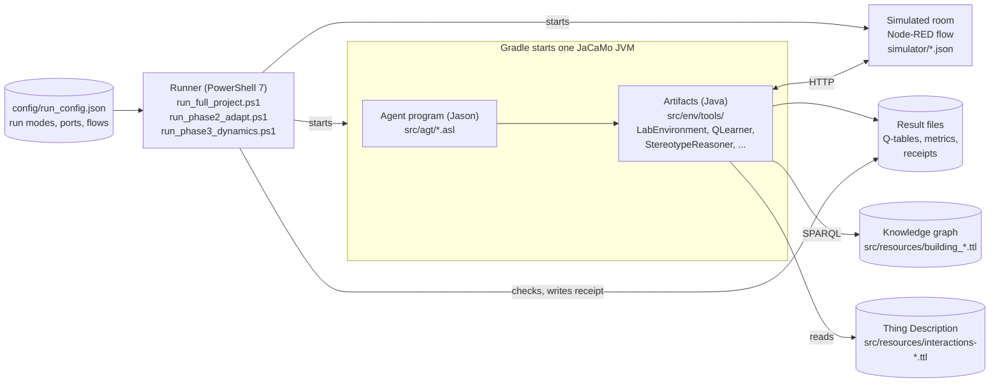

# Knowledge-guided Q-learning for light control in simulated rooms

This repository is the code and data of a master's thesis. One BDI agent (belief, desire,
intention: a program that keeps facts as beliefs and acts by running plans) on the JaCaMo
platform learns by tabular Q-learning to bring the light in simulated rooms ("labs") to a
target level by switching lamps and opening or closing blinds. The agent program is written
for Jason, the interpreter of the agent language AgentSpeak; its tools are CArtAgO
*artifacts*, Java objects whose operations the agent calls like actions. Q-learning keeps a
table, the *Q-table*, with one value for every pair of room state and action, and improves
it from the rewards it receives; the light of every zone is counted in *ranks* from 0 (dark)
to 3 (bright), and the target is a rank per zone. Each lab is a Node-RED flow that the agent
reaches over HTTP through a W3C Web of Things Thing Description, and each lab has a
knowledge graph that describes the room with the Brick vocabulary and with component
*stereotypes* from the Elementary ontology (a stereotype describes a kind of device: which
physical mechanism it has, what it changes and what that depends on, for example a blind
that gives light only when the sun shines; Ramanathan and Mayer, "Reasoning about Physical
Processes in Buildings through Component Stereotypes", BuildSys 2023; journal version
Data-Centric Engineering 5:e40, 2024). The experiments compare a learner that uses this
knowledge for its starting values and as a soft preference among actions (`ql_true`)
with the same learner without it (`ql_false`), with a hand-written rule controller
(`rule_based`) as a reference. They run in four phases, as GitHub Actions workflows, and
their accepted results are archived under `results/` together with the scripts that
re-check them:

- **Phase 1**, normal physics: does the knowledge help the learner in rooms that behave
  as the graph says? Its extension **Phase 1b** varies how much of the graph is relevant
  and in which direction a device acts.
- **Phase 2**, faults: a device is broken; how quickly do the two learners notice and
  recover?
- **Phase 3**, slow devices: the agent measures how long a device takes to act and plans
  against deadlines.
- **Phase 4**, hidden dependencies and energy: lamps behind smart plugs, and devices that
  cost energy.

A *campaign* is the set of GitHub runs made for one written plan and archived in one
folder under `results/`. An analysis is called *registered* when that plan (a registration
in `docs/registrations/`) fixed it in writing; the registrations state when they were
written relative to the data. The *Q-gap study* is an exploratory look back at Phase-2
data (`results/exploratory/phase2b_qgap/`).

The words of the knowledge graphs (Brick, Elementary, stereotype and the project's own
terms) are explained in [docs/VOCABULARY.md](docs/VOCABULARY.md), the words of the
experiments (arm, seed, cell, run mode, receipt) in section 1 of
[docs/EXPERIMENTS.md](docs/EXPERIMENTS.md), and the agent platform (BDI, Jason, CArtAgO) in
section 1 of [docs/ARCHITECTURE.md](docs/ARCHITECTURE.md).

## Contents

- [How the parts fit together](#how-the-parts-fit-together)
- [What is in the repository](#what-is-in-the-repository)
- [Requirements and installation](#requirements-and-installation)
- [Quick start](#quick-start)
- [Checking the stored results](#checking-the-stored-results)
- [Checking one number of the thesis](#checking-one-number-of-the-thesis)
- [Registrations, reports and results](#registrations-reports-and-results)
- [Further documentation](#further-documentation)
- [Aids](#aids)

## How the parts fit together



A runner reads a *run mode* (a named bundle of settings) from `config/run_config.json`,
starts the Node-RED flow of the requested lab on that lab's port, and starts the agent
through Gradle. The agent program calls the artifacts: `LabEnvironment` reads the room and
sends switch commands, `QLearner` learns, and `StereotypeReasoner` (a plain Java class used
by `QLearner`) reads the knowledge graph once at start-up. When the agent has finished, the
runner checks the output and writes a *receipt*: a small JSON file that records the
settings the cell really ran with and that it passed its checks (later steps and the
archive checks refuse a cell without one). The details, with file names for every
part, are in [docs/ARCHITECTURE.md](docs/ARCHITECTURE.md).

## What is in the repository

| Path | Contents |
|---|---|
| `src/agt/` | Agent programs (Jason `.asl`): training, test, fault stage, delay learning, and `lab_profiles.asl`, the list of labs. |
| `src/env/tools/` | Artifacts and helper classes in Java (room connection, learner, knowledge reader, test recorder, delay learner, command-line checks). |
| `src/resources/` | Knowledge graphs (`building_*.ttl`), Thing Descriptions (`interactions-*.ttl`), logging configuration. |
| `src/test/java/` | Java unit tests (JUnit 5). |
| `simulator/` | Node-RED flows, one per lab, and `generate_faulty_flows.ps1`, which writes the flows with broken devices. |
| `benchmark/` | Start situations: `scenarios_<lab>.json` (test) and `train_scenarios_<lab>.json` (training). |
| `config/` | `run_config.json` (run modes, ports, phase settings) and its schema, `knowledge_provenance.csv`, the reference action lists (`golden_registry/`) and the Phase-1b reachability certificates. |
| `task*.jcm` | JaCaMo project files; each starts one agent program. |
| `run_full_project.ps1`, `run_phase2_adapt.ps1`, `run_phase3_dynamics.ps1` | The runners (training and test; fault stage; delay learning). |
| `build.gradle`, `gradlew`, `gradlew.bat`, `gradle/`, `gradle.properties` | Gradle build (wrapper version 8.13). |
| `requirements.txt` | The third-party Python packages of the analysis scripts and tests. |
| `.github/workflows/` | `ci.yml` (routine checks) and `phase1.yml` to `phase4.yml` (experiments). |
| `analysis/` | Python analysis: the registered analysis and reproduction script of every campaign, archive validators, `check_pins.py`, post-hoc summaries (`posthoc/`), and the tests (`tests/`). |
| `scripts/` | Helper scripts: archive curation and download, configuration reader, publishing to the `results` branch, the Phase-1b flow smoke check, and `make_labs_doc.py`, which writes `docs/LABS.md`. |
| `results/` | The archived result data of the accepted and exploratory campaigns, and `pins/` with the pinned facts of each archive. See [results/README.md](results/README.md). |
| `docs/` | Documentation, registrations, notices and reports. See [docs/README.md](docs/README.md). |
| `dashboard/` | A small web page that shows the results; see `dashboard/README.md`. |
| `.node-red-<lab>/` | Node-RED settings folders; the runners use them as the simulator's user directory. |
| `.githooks/` | An optional pre-commit hook that warns before raw result files are committed. |
| `logging.properties` | Java logging settings of the agent platform. |

## Requirements and installation

Each tool is needed in the stated version or a newer one. The first column gives what the
GitHub workflows (`.github/workflows/ci.yml` and `phase1.yml` to `phase4.yml`) install on
their Ubuntu runners. The second gives the versions installed on the Windows 11
development computer at the last check, with which the build, the tests and the checks
of this README were run; the cells of the quick start were run on the same computer
earlier.

| Tool | As in the workflows (Ubuntu) | Also used with (Windows 11) | Needed for |
|---|---|---|---|
| Java (JDK) | 21 or newer (Temurin 21) | 23 | building and running the agent |
| Node.js | 20 or newer | 22.14 | Node-RED |
| Node-RED | 4 (`npm install -g --unsafe-perm node-red@4`) | 4.1.8 | the simulated rooms |
| PowerShell | 7 or newer (`pwsh`, preinstalled on the runners) | 7.7 | the runners |
| Python | 3.11 or newer, with the packages in `requirements.txt` | 3.12 | analysis, checks, tests |
| GitHub CLI `gh` | any recent version | 2.92 | only for starting workflows and downloading their artifacts |

The workflows install `numpy`, `scipy`, `matplotlib` and `pytest` without a version, so
they always get the newest release; `requirements.txt` lists the same four packages, with
lower bounds at versions with which the tests and reproducers passed (numpy 2.4, scipy
1.17, matplotlib 3.10 and pytest 9.0 on the development computer). Gradle itself is
downloaded by the wrapper (`gradlew`), and the Java libraries (JaCaMo, the WoT Thing
Description library, Apache Jena and others, see `build.gradle`) are downloaded from Maven
Central, JitPack and the JaCaMo repository on the first build, so the first build needs an
internet connection. JitPack is at times slow or briefly unavailable; if the first build
stops with a message that a dependency could not be resolved, run the same command again
(the workflows retry up to three times for this reason).

Which versions are installed:

```powershell
java -version
node --version
node-red --version     # prints the Node-RED and the Node.js version
pwsh --version
py -3 --version        # Linux / macOS: python3 --version
gh --version
```

Installation, after cloning the repository. On Windows (PowerShell), with a virtual
environment for the Python packages:

```powershell
npm install -g --unsafe-perm node-red@4
py -3 -m venv .venv
.\.venv\Scripts\Activate.ps1
python -m pip install -r requirements.txt
```

On Linux and macOS the same steps are `python3 -m venv .venv`, `source .venv/bin/activate`
and `python -m pip install -r requirements.txt`; installing Node-RED globally may need
`sudo`. The folder `.venv/` is listed in `.gitignore`; the environment can as well be
created outside the repository. Inside an
activated environment, write `python` where this documentation writes `py -3`: on Windows
`py -3` always starts the installed Python, not the one of the environment. Without a
virtual environment,
`py -3 -m pip install -r requirements.txt` installs the packages for the installed Python.

What the runners need on the `PATH`:

- all three runners (`run_full_project.ps1`, `run_phase2_adapt.ps1`,
  `run_phase3_dynamics.ps1`): `node-red` (on Windows `node-red.cmd`, which
  `npm install -g` creates); they stop with the message `node-red not found in PATH` if it
  is missing (the message suggests `npm install -g node-red`; install `node-red@4` as
  above). They start Gradle through `gradlew.bat` or `gradlew` in the repository root,
  which needs a JDK through `JAVA_HOME` or `java` on the `PATH`.
- `run_full_project.ps1` also needs a Python 3: it uses the first of `py`, `python3` and
  `python` that really runs and reports version 3, and stops with a message that begins
  `Python 3 not found: tried 'py -3', 'python3' and 'python'` if there is none. It
  runs Python only after a test (`analysis/sweep_report.py`, a summary that is not needed
  for the cell's files; a failure there gives a warning, not an error). With `py` it calls
  `py -3`, so the packages must be installed for the installed Python, not only in a
  virtual environment. The other two runners do not call Python.
- Some helper scripts call `python` directly: `scripts/Run-Phase1bFlowSmoke.ps1` (`python`,
  then `python3`) and `scripts/curate_phase1b_confirmatory.ps1` (`python`).

On Windows, `python` and `python3` can be the Microsoft Store placeholders in
`%LOCALAPPDATA%\Microsoft\WindowsApps`, which open the Store instead of running Python
(`(Get-Command python).Source` shows which one is found). Install Python from
<https://www.python.org/> (the installer includes the launcher `py`) and use `py -3`, or an
activated virtual environment, in which `python` is the real interpreter; alternatively
switch off the aliases `python.exe` and `python3.exe` under Settings > Apps > Advanced app
settings > App execution aliases.

Line endings need no attention and no special clone option: `.gitattributes` starts with
`* -text`, so git checks out every file exactly as it was committed (the code,
configuration and scenario files with LF line endings) on every system and with every
`core.autocrlf` setting. The checksums that receipts and pins files store for input files
(for example the scenario files in `benchmark/`) therefore match on Windows too.

## Quick start

All commands are run from the repository root in PowerShell 7. They are written in the
Windows form: `py -3` for Python and `.\gradlew.bat` for Gradle. On Linux and macOS write
`python3` and `./gradlew` instead (or `python` inside an activated virtual environment); the
`pwsh -NoProfile -File ./run_....ps1` lines are the same on every system. The runners have
been used on Windows 11 (the development computer) and on Ubuntu (the GitHub workflows);
they have not been tested on macOS.

The times below were measured on the development computer. A second measurement of the
steps that start no simulator, made on the same computer while other jobs were running,
took two to three times as long: the first `classes` build (with the downloads) 2 minutes
13 seconds, `test` 38 seconds, the Python tests 9 minutes, `check_pins.py` almost
4 minutes. Allow two to three times the stated times.

### 1. Build and run the tests

```powershell
.\gradlew.bat --no-daemon classes
.\gradlew.bat --no-daemon test
py -3 -m pytest -q -p no:cacheprovider analysis/tests
.\gradlew.bat --no-daemon validateTurtle
.\gradlew.bat --no-daemon preflight "-Pprofiles=lab1,lab2,lab3" -PskipSimProbe
```

`test` runs the Java unit tests, the third line the Python tests (`-p no:cacheprovider`
keeps pytest from writing a cache folder), and `validateTurtle` checks that every `.ttl`
file parses. `preflight` parses every Turtle file, compares the action list the program
derives for every lab with the stored reference in `config/golden_registry/`, and checks
that the listed labs have their files; `-PskipSimProbe` skips the check that their
simulators answer. Keep the quotes around `"-Pprofiles=..."`: without them PowerShell
splits the argument at the commas. On the development computer `test` took about half a
minute and the Python tests between about three and six minutes.

The Python tests end with `454 passed` in a full clone. In a shallow clone
(`git clone --depth 1`) or in a ZIP download, two tests of the Q-gap study, which read
pinned files from the git history, are skipped with a message, and the result is
`452 passed, 2 skipped`. Tests that call PowerShell or Node.js are skipped in the same way
when `pwsh` or `node` is missing. A shallow or single-branch clone also has no git tags:
`git fetch --tags` fetches them (and `git fetch --unshallow` the history). A ZIP download
has neither, so `git checkout record-v2.5.0-pre-cleanup` needs a git clone.
`analysis/check_pins.py` needs no git history.

### 2. What the runners do

The runners start everything themselves. You do not start Node-RED by hand:

- A runner starts the Node-RED flow of the requested lab on that lab's port (for example
  1892 for lab1, 1893 for lab2 and its fault variants, 1895 for lab2_slow; the full list
  is in [docs/LABS.md](docs/LABS.md)), waits for its `/health` answer, runs the agent
  through Gradle, and stops the flow at the end.
- The port must be free. Before it starts a flow, a runner checks the port; if another
  process holds it, the runner stops with `Port <port> is already in use, so the <lab>
  simulator cannot be started there. Held by: PID <id> (<name>): <command line>`. After
  the start it checks that the simulator which answers is the flow it started: every
  flow's `/health` answer names its lab in the field `profile`, and a different or missing
  name stops the run (`Wrong simulator on port ...`). The receipts record that name
  (`simulator_profile_reported`) and the flow file (`simulator_flow`). At the end the
  runner stops the Node-RED process it started together with all its child processes
  (`Stopped simulator on port <port> (process tree: <ids>; ...)`) and waits until the port
  is free.
- `run_full_project.ps1` writes the settings of the run mode into some tracked files while
  it runs: the simulator tick into the flow files, the episode count into
  `src/agt/lab_profiles.asl`, the arm into `src/agt/illuminance_controller_agent_ql.asl`,
  and timing values into that file and `src/agt/illuminance_controller_agent_bench.asl`.
  It restores `lab_profiles.asl` and the arm line afterwards but leaves the run mode's
  timing values in the two agent programs, so `git status` can show them as modified after
  a run. `git checkout -- src/agt simulator` returns them to the committed state.
- Outputs are written into the repository root and under `benchmark/results/`, `log/`
  and `analysis/out/`; git ignores them, except the fault and delay receipts
  (`ADAPT_OK_*.json`, `DYNAMICS_OK_*.json`), which appear as untracked files.

**What you see while a cell runs.** The runner prints its steps between lines of `═`
characters, with `[OK]` for a passed step, `[..]` for information, `[!!]` for a warning and
`[XX]` for an error, and writes the same lines to its log file in the root
(`run_full_project.log`, `run_phase2_adapt.log` or `run_phase3_dynamics.log`). The agent's
own output goes to a log file under `log/`, named in each step below. A training cell
shows a progress line from that log every 15 seconds. Each runner ends with a section
`Cleanup`, in which it stops the simulator it started (`[OK]  Stopped simulator on port
...`). It exits with code 0 on success and 1 on an error; `$LASTEXITCODE` shows the code
afterwards.

**How to stop a cell.** Press Ctrl+C in the window of the runner. The runner then runs its
`Cleanup` section, which stops the simulator's process tree. Stopping a cell this way has
not been tested systematically, so check afterwards that nothing of the run is left: in
training, fault and delay cells the Gradle and Java processes run as a separate process
(on Windows in a hidden window) that the clean-up does not stop, and a process that still
holds the lab's port makes the next run stop with the `Port ... is already in use`
message above, which names it. On Windows,
`Get-NetTCPConnection -State Listen -LocalPort 1892` (with the lab's port) names the
process that still listens (`OwningProcess`), and
`Get-CimInstance Win32_Process -Filter "Name='java.exe'" | Select-Object ProcessId, CommandLine`
lists the Java processes; stop a leftover one with `Stop-Process -Id <id>`. On Linux,
`ps -ef | grep -E 'node-red|java'` lists them. Then run `git checkout -- src/agt simulator`.
A stopped cell writes no receipt, and a receipt is the only sign that a cell completed.

### 3. One training cell (about 20 minutes)

A *cell* is one combination of lab, arm and seed (the number that fixes the agent's
random choices). This is the cell the CI workflow runs as its smoke test: lab1, knowledge
arm, seed 1, with the full 3,000 training episodes that the run mode requires.

```powershell
pwsh -NoProfile -File ./run_full_project.ps1 -RunMode phase1_v2_kg_only -OnlyProfiles lab1 -OnlyStereo true -RunSeed 1 -SkipBenchmark -SkipPreflight
```

On the development computer it took about 18 minutes. It writes the Q-tables
(`qtable_final_stereotypes_true_lab1*.csv`), the training metrics
(`metrics_stereotypes_true_lab1.csv`) and further files into the root, a copy of them with
the receipt `TRAINING_OK.json` into `benchmark/results/lab1/training_stereo_true/`, and the
agent's log to `log/train_lab1_stereo_true.log`.

- **Success:** the progress lines reach `[Training] ep 3000/3000`, the runner prints
  `Artefacts archived → benchmark\results\lab1\training_stereo_true` and then the header
  `All phases complete`, and exits with code 0.
- **Receipt:** `benchmark/results/lab1/training_stereo_true/TRAINING_OK.json` with
  `"status": "ok"`.
- **Running it again:** a training cell whose receipt exists is skipped
  (`Already trained (manifest present) — skipping`); delete the folder
  `benchmark/results/lab1/training_stereo_true/` to train it again.

### 4. One test cell (about 2 minutes)

A test cell needs the trained tables of both arms of its lab and seed. Instead of training
them, copy the archived tables of lab2, seed 1 from the Phase-1 archive:

```powershell
$src = "results/phase1_v2_corrected/run_29848584965/benchmark/results_seed1/lab2"
Get-ChildItem "$src/ql_true" -File |
    Where-Object Name -Match '^(qtable_final|metrics|iv_stats|coverage|first_goal|learned)_stereotypes_' |
    Copy-Item -Destination .
foreach ($b in 'true', 'false') {
    Copy-Item "$src/training_stereo_$b/qtable_initial_*" -Destination .
    New-Item -ItemType Directory -Force "benchmark/results/lab2/training_stereo_$b" | Out-Null
    Copy-Item "$src/training_stereo_$b/*" -Destination "benchmark/results/lab2/training_stereo_$b"
}
```

Then run the test of the knowledge arm (`-OnlyModes ql_false` or `rule_based` run the
other two contestants):

```powershell
pwsh -NoProfile -File ./run_full_project.ps1 -RunMode phase1_v2_kg_only -OnlyProfiles lab2 -OnlyModes ql_true -RunSeed 1 -SkipTraining -SkipPreflight
```

It plays each of the 16 test situations of lab2 five times and writes
`benchmark_results_ql_true.csv` and `bench_step_log_ql_true.csv` (in the root and in
`benchmark/results/lab2/ql_true/`); the agent's log is `log/benchmark_sweep.log`. Because
training and test are deterministic, these files can be compared with the archived ones;
see [docs/REPRODUCING.md](docs/REPRODUCING.md).

- **Success:** the runner first prints `SkipTraining validation passed for all profile ×
  stereotype cells.` (it has found the two training receipts), then
  `Benchmark sweep complete in ... min` and the header `All phases complete`, and exits
  with code 0. After the test it runs the summary `analysis/sweep_report.py`; if Python
  or its packages are missing there, it prints a warning and the cell's files are still
  complete.
- **Receipt:** a test cell writes no receipt of its own. Its result files are the two CSV
  files; it refuses to start unless both training receipts of its lab exist.

### 5. One fault-stage smoke cell (about 2 minutes)

The fault stage loads the table the same arm learned in the healthy lab (here the lab2
tables copied in step 4) into a lab with a broken device and lets the agent find and
remove it. `-Smoke` limits the re-learning to 200 episodes (`phase2.smoke_episodes`).

```powershell
pwsh -NoProfile -File ./simulator/generate_faulty_flows.ps1
pwsh -NoProfile -File ./run_phase2_adapt.ps1 -Smoke -AdaptProfiles lab2_f1bdead -Modes ql_true -RunSeed 1 -KnowledgeLayer full
```

The first command writes the flows with broken devices from the healthy flows, as the
Phase-2 workflow does before every fault cell. The committed faulty flows are exactly its
output, so on a clean checkout it changes no file (`git status` stays empty).
The cell writes `recovery_stereotypes_true_lab2_f1bdead.csv` (which device was blamed,
when it was detected, when the behaviour settled), the re-learned table, the episode
metrics and the receipt `ADAPT_OK_stereotypes_true_lab2_f1bdead.json`. Without parent
tables in the root the agent starts from an empty table and the receipt says
`"status": "cold_start"`. The agent's log is `log/adapt_lab2_f1bdead_ql_true.log`.
The runner's `-SettingsProfile` option (default `record`, the settings of the archived
campaigns) selects the learning settings of the fault stage; see
[docs/EXPERIMENTS.md](docs/EXPERIMENTS.md).

- **Success:** the runner prints `Done in ...m  defect=...  detect=...`, then
  `ADAPT_OK manifest written: ADAPT_OK_stereotypes_true_lab2_f1bdead.json`, a section
  `Phase 2 summary` and, at the end, `Phase 2 run finished cleanly.`; it exits with code 0.
- **Receipt:** `ADAPT_OK_stereotypes_true_lab2_f1bdead.json` in the repository root, with
  `"status": "ok"` (or `"cold_start"`, see above).

### 6. One delay-learning smoke cell (about 1 minute)

```powershell
pwsh -NoProfile -File ./run_phase3_dynamics.ps1 -Smoke -DynamicsProfiles lab2_slow -Modes ql_true
```

The agent measures the response delay of every device of `lab2_slow` three times
(`phase3.smoke_probes`), then plans the six deadline goals. It writes
`dynamics_delays_true_lab2_slow.csv`, `timebounded_results_true_lab2_slow.csv`,
`learned_dynamics_true_lab2_slow.ttl` and the receipt `DYNAMICS_OK_true_lab2_slow.json`;
the agent's log is `log/dynamics_lab2_slow_ql_true.log`. The measured delays depend on
timing, so they can differ slightly from run to run.

- **Success:** the runner prints `Done in ...m  met=...`, then
  `DYNAMICS_OK manifest written: DYNAMICS_OK_true_lab2_slow.json`, a section
  `Phase 3 summary` and, at the end, `Phase 3 run finished cleanly.`; it exits with code 0.
- **Receipt:** `DYNAMICS_OK_true_lab2_slow.json` in the repository root, with
  `"status": "ok"`.

The run times of steps 3 to 6 were measured only on the development computer (Windows 11).
The full campaigns are not meant to be run locally; they run on GitHub Actions, see
[docs/EXPERIMENTS.md](docs/EXPERIMENTS.md).

## Checking the stored results

Every archive under `results/` has a pins file `results/pins/<campaign>.json` that
states the facts it must keep: the dispatch receipts of its runs, key values of its
registered tables, and SHA-256 checksums of its files.

```powershell
py -3 analysis/check_pins.py                    # all archives against their pins (about 1 minute)
py -3 analysis/check_pins.py --run-reproducers  # also rebuild the registered tables (about 5 minutes)
py -3 analysis/check_pins.py --only phase2_v3_structonly --run-reproducers
```

The first command ends with `pins check OK (12 archive(s))`. `--run-reproducers` then
runs the reproduction script of every archive whose inputs are in the repository: it
recomputes the registered tables from the stored per-cell data, compares them with the
stored tables, and prints one `[reproducer] <campaign>: OK in ... s` line per archive and
`reproducers OK` at the end. Four archives (`phase1b_corrected`, `phase1b_extended_v3`,
`phase4_v2_corrected`, `phase4_v2_ladder`) need bulky raw files that are not in the
repository; they print `needs local raw data; not run (use --include-local)`, and their
stored tables are still checked against their pins. The three exploratory archives print
`none (...)`: they have no reproducer, and the text in brackets says why (see
[results/README.md](results/README.md)). Both commands also run in the CI workflow. The
raw data, where they came from and until when they can be downloaded, are described in
[docs/REPRODUCING.md](docs/REPRODUCING.md).

## Checking one number of the thesis

The thesis text is not part of this repository; its result tables are built from the
registered tables stored here. To check one number:

1. Find the campaign that produced it. The table "Which script do I need to check
   number X?" in [analysis/README.md](analysis/README.md) and the campaign sections of
   [results/README.md](results/README.md) name the campaign for every kind of result.
2. Open the campaign's registered table under `results/<campaign>/analysis/registered/`
   (listed for each campaign in [results/README.md](results/README.md)) and find the row
   and column of the number.
3. Rebuild the table from the stored per-cell files and compare it with the stored one:
   `py -3 analysis/check_pins.py --only <campaign> --run-reproducers`.
4. The pins file `results/pins/<campaign>.json` names the runs (their run ids, run modes
   and seeds) and the commit (`head_sha`) at which they were made, and fixes the key values
   of the table; the run folders `results/<campaign>/run_<run id>/` hold the per-cell files.

Example: the effect of the full knowledge on learning in lab2 (Phase 1). In
`results/phase1_v2_corrected/analysis/registered/phase1_v2_registered_family.csv`, row
`1_arm_c_lab2_auc_goal`, column `mean_paired_difference` holds `0.0036999999999999976`
(about +0.0037: the mean over 20 seeds of the knowledge arm's area under the goal curve
minus that of the plain arm). The command

```powershell
py -3 analysis/check_pins.py --only phase1_v2_corrected --run-reproducers
```

checks the archive against `results/pins/phase1_v2_corrected.json`, which pins this value
as `0.0037`, and rebuilds the table; it ends with
`[reproducer] phase1_v2_corrected: OK in ... s (All corrected Phase-1 canonical numeric CSVs are byte-equivalent.)`
and `reproducers OK` (about 4 minutes). The pins file names the five runs of the archive;
this row comes from run `29848584965` (run mode `phase1_v2_kg_only`, seeds 1 to 20,
commit `d3442385`), whose per-cell files are under
`results/phase1_v2_corrected/run_29848584965/benchmark/`. The registration that fixed this
test before the data existed is named in [docs/README.md](docs/README.md).

## Registrations, reports and results

Every campaign has a written registration that states when it was written relative to
its data; exploratory analyses are marked as such. The registrations, dispatch records,
withdrawal notices and result reports are in `docs/registrations/`, `docs/notices/` and
`docs/reports/`, indexed in [docs/README.md](docs/README.md).
The archived results, with run identifiers, reproduction scripts and the reports that
belong to them, are described campaign by campaign in [results/README.md](results/README.md).
The result tables themselves are the files under `results/<campaign>/analysis/registered/`
and the reports in `docs/reports/`; this README makes no claims about them.

The complete earlier state of the repository, including all working documents of the
development and every withdrawn result, is kept at the git tag
`record-v2.5.0-pre-cleanup` (`git checkout record-v2.5.0-pre-cleanup`). How the project
developed is summarised in [docs/DEVELOPMENT_HISTORY.md](docs/DEVELOPMENT_HISTORY.md).

## Further documentation

| Document | Contents |
|---|---|
| [docs/ARCHITECTURE.md](docs/ARCHITECTURE.md) | The parts, the learning loop, how knowledge enters, fault handling, delay learning. |
| [docs/LABS.md](docs/LABS.md) | Every lab: zones, devices, light formula as coded, sun levels, targets, ports, files (generated). |
| [docs/EXPERIMENTS.md](docs/EXPERIMENTS.md) | Phases, arms, run modes, seeds, workflows, receipts, how a campaign is run and archived. |
| [docs/REPRODUCING.md](docs/REPRODUCING.md) | Three levels of re-checking the results. |
| [docs/VOCABULARY.md](docs/VOCABULARY.md) | The vocabularies of the knowledge graphs and which terms are the project's own. |
| [docs/KNOWLEDGE_PROVENANCE.md](docs/KNOWLEDGE_PROVENANCE.md) | The binding table that assigns every knowledge-graph term to a knowledge layer (with `config/knowledge_provenance.csv`). |
| [docs/DEVELOPMENT_HISTORY.md](docs/DEVELOPMENT_HISTORY.md) | How the project developed. |
| [docs/DEMO_GUIDE.md](docs/DEMO_GUIDE.md) | How to give a live demonstration with the dashboard. |
| [docs/evidence/reproduction_check_2026-11/README.md](docs/evidence/reproduction_check_2026-11/README.md) | Seven sample runs on GitHub Actions compared file by file with the archives. |
| [docs/README.md](docs/README.md) | Index of all documents, including registrations, notices, reports and evidence. |
| [results/README.md](results/README.md) | The archives campaign by campaign: runs, commits, registrations, registered tables, reproducers. |
| [analysis/README.md](analysis/README.md) | Every analysis script: what it computes, which archive it reads, who calls it. |
| [scripts/README.md](scripts/README.md) | The helper scripts (configuration reader, archive curation and download, publishing). |
| [src/README.md](src/README.md) | The source tree: agent programs, artifacts and helper classes, resources, tests. |
| [dashboard/README.md](dashboard/README.md) | The demonstration dashboard: how to start it and where its data come from. |

References: Brick schema, <https://brickschema.org/>; Elementary ontology,
<https://github.com/autonomous-buildings/elementary>; W3C Web of Things Thing
Description, <https://www.w3.org/TR/wot-thing-description/>; JaCaMo,
<https://jacamo-lang.github.io/>; Node-RED, <https://nodered.org/>.

## Aids

| Aid / tool | Purpose | Where |
|---|---|---|
| Claude Code (Anthropic, Claude large language models) | Writing, reviewing and testing the code of the agent, the simulated labs, the runner scripts and the analysis scripts; running and monitoring the experiment campaigns; drafting and revising the documentation | The code repository |
| JaCaMo (Jason, CArtAgO) | Agent platform: the BDI agent and its artifact tools | `src/` |
| Apache Jena ARQ | Loads the Turtle knowledge graphs and runs the SPARQL queries | `src/` |
| wot-td-java | Reads the W3C Web of Things Thing Descriptions | `src/` |
| Node-RED | The simulated rooms ("labs") | the `.node-red-*` folders |
| Brick and Elementary | Vocabularies of the knowledge graphs | `src/resources/` |
| GitHub Actions | Ran the experiment campaigns whose archives are in `results/` | `.github/workflows/` |
| Python 3.11 with NumPy, SciPy, Matplotlib, pytest | Statistics, figures and tests of the analysis | `analysis/`, `scripts/` |
| React and Vite | The demo dashboard | `dashboard/` |
