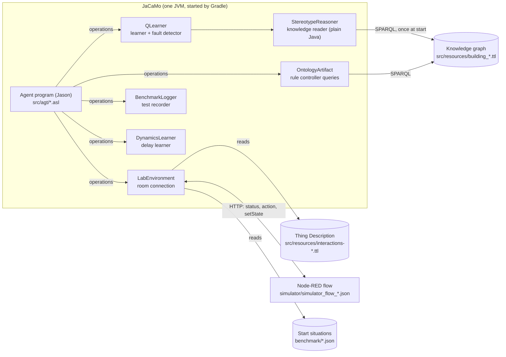

# Architecture

This document describes the parts of the system, how they talk to each other, and where
each part lives in the repository. It describes the code as it is; the reasons behind
the experiments are in [EXPERIMENTS.md](EXPERIMENTS.md), the rooms in [LABS.md](LABS.md),
and the vocabulary of the knowledge graphs in [VOCABULARY.md](VOCABULARY.md).

## 1. Overview

The system is one BDI agent (belief, desire, intention: the agent holds facts as beliefs
and acts by running *plans*) on the JaCaMo platform. JaCaMo combines three things; this
project uses two of them:

- **Jason** runs the agent program, written in AgentSpeak (`.asl` files). The program
  decides what happens in which order: connect to a room, run episodes, save files.
- **CArtAgO** provides *artifacts*: Java objects that the agent creates and whose
  *operations* it calls like actions. All arithmetic (learning, reasoning over the
  knowledge graph, HTTP) happens in artifacts.

Each run starts exactly one agent program. The room is not real: it is a simulated room
("lab") running as a Node-RED flow. The agent reaches it over HTTP, guided by a W3C Web
of Things (WoT) Thing Description of the room.



## 2. The parts and where they are

### 2.1 Agent programs (`src/agt/`)

| File | Gradle task | JaCaMo file | What it does |
|---|---|---|---|
| `illuminance_controller_agent_ql.asl` | `taskQl` | `task_ql.jcm` | Training: runs the episodes, lets the learner update its table, saves the table and the training metrics. |
| `illuminance_controller_agent_bench.asl` | `runFullSweep` (used by the runner), `taskBench` (one cell by hand) | `task_bench.jcm` | Test: loads a trained table and plays the test situations without exploring; or, in mode `rule_based`, controls the room with fixed rules over the knowledge graph. |
| `illuminance_controller_agent_adapt.asl` | `taskAdapt` | `task_adapt.jcm` | Fault stage (Phase 2): loads a table trained in the healthy room, watches for broken devices, removes them, learns again. |
| `illuminance_controller_agent_dynamics.asl` | `taskDynamics` | `task_dynamics.jcm` | Delay learning (Phase 3): measures how long each device takes to act, then meets goals with deadlines. |
| `lab_profiles.asl` | – | – | Not a program: the list of lab profiles that the other programs include (device description, knowledge graph, scenario files, rank bounds, targets, episode budget and exploration decay per lab). |

`run_full_project.ps1` starts the test phase through the Gradle task `runFullSweep`
(`-Pprofiles=<labs> -Pmodes=<modes>`), which runs `task_bench.jcm` once for every pair of
lab and mode, one after the other; `taskBench` runs the same program for a single lab and
mode and is not called by any runner or workflow. There is no Gradle default task. A
former rule-based demonstration agent (`illuminance_controller_agent.asl`, `task.jcm`,
Gradle task `task`) was removed; it is kept at the git tag `record-v2.5.0-pre-cleanup`.

The programs read run-time settings that Gradle passes as Java system properties
(`-Pprofile=...` becomes `active.profile`, `-Pmode=...` becomes `bench.mode`,
`adapt.mode` or `dynamics.mode`) through the two small internal actions in
`src/env/tools/jia/` (`system_prop`, `system_prop_num`).

### 2.2 Artifacts and helper classes (`src/env/tools/`)

| Class | Role |
|---|---|
| `LabEnvironment` | Room connection. Loads the Thing Description, reads the room's status, sends switch commands (`invokeAction`), puts the room into a start situation (`setScenarioLabStateByPosition` and related operations), and turns lux values into ranks (`discretize`). |
| `SimulatorHttpClient` | HTTP client with time-outs and retries, used by `LabEnvironment`. |
| `WotInputValidator` | Checks every command and every start situation against the Thing Description before it is sent. |
| `ScenarioCatalog` | Strict loader for the scenario files in `benchmark/` (every row needs an `id`; positions are read in file order). |
| `QLearner` | The learner: per-zone Q-tables, reward, update rule, action choice, knowledge preference, fault detector, recovery detector, file output. The largest class of the project. |
| `StereotypeReasoner` | The knowledge reader. A plain Java class owned by `QLearner`, not an artifact. Runs SPARQL queries over the lab's knowledge graph once at start-up and derives the action list, the state layout, the starting values, the preferences and the predicted effect of every action. |
| `OntologyArtifact` | SPARQL queries used by the rule controller (`rule_based` test mode), for example `queryBestIncreaseAction` / `queryBestDecreaseAction`. |
| `BenchmarkLogger` | Test recorder: one row per test run in `benchmark_results_<mode>.csv` and one row per step in `bench_step_log_<mode>.csv`. |
| `Phase1PolicyEnergy` | The deterministic energy cost of the active devices that `BenchmarkLogger` reports as `PolicyEnergyCost`. |
| `FirstGoalPresentationTracker` | Records, per training situation, at which presentation the goal was first reached (`first_goal_stereotypes_*.csv`). |
| `StereotypeLearner` | Records the observed effect of every action and writes it as `learned_stereotypes_*.ttl`. |
| `DynamicsLearner` | Delay learner (Phase 3): running mean and variance of each device's response delay; writes `learned_dynamics_*.ttl` and the delay table. |
| `TurtleValidator`, `RegistryGoldenCheck`, `ActionRegistryDump`, `OverlaySynthesizer`, `Phase1SparqlEvidence` | Command-line tools behind the Gradle tasks `validateTurtle`, `verifyActionRegistry`, `dumpActionRegistry`, `synthesizeOverlay` and `phase1SparqlEvidence`. |
| `Converters`, `LoggingBootstrap` | Small helpers (type conversion, logging set-up). |

### 2.3 Knowledge and device descriptions (`src/resources/`)

- `building_*.ttl`: one knowledge graph per lab, in Turtle format. It describes the room
  with the Brick vocabulary (which device is in which zone and lights which sensor), with
  component stereotypes from the Elementary ontology (what kind of physical mechanism a
  device has), and with a WoT mapping section that lists every switch and every entry of
  the state. See [VOCABULARY.md](VOCABULARY.md).
- `interactions-*.ttl`: one W3C WoT Thing Description per lab: the HTTP forms for reading
  the status and for each action.
- `lab-ontology.ttl`, `wot-mappings.ttl`, `interactions-lab-custom2.ttl`: files of the
  early two- and four-zone `custom*` labs, which no longer exist (they are kept at the git
  tag `record-v2.5.0-pre-cleanup`). No lab profile uses these three files; they remain
  because the action-list check `verifyActionRegistry` (ontology set `custom`, reference
  `config/golden_registry/registry_custom.csv`) and three Java unit tests read them.

Which files a lab uses is stated in its profile in `src/agt/lab_profiles.asl` and listed
per lab in [LABS.md](LABS.md).

### 2.4 Simulator (`simulator/`)

One Node-RED flow per lab (`simulator_flow_<lab>.json`). Each flow keeps the switch
positions and the sun level, recomputes the light of every zone every 50 milliseconds,
and answers `GET /was/rl/status`, `POST /was/rl/action`, `POST /was/rl/setState`,
`POST /was/rl/reset` and `GET /health`. The physics functions of the current labs contain
no random numbers. `simulator/generate_faulty_flows.ps1` writes the flows with broken
devices from the healthy flows. [LABS.md](LABS.md) gives each lab's light formula as coded.

### 2.5 Runners, configuration and workflows

- `config/run_config.json`: the named *run modes* (bundles of settings), the lab-to-port
  and lab-to-flow maps, the learning settings, and one block per phase. Its schema is
  `config/run_config.schema.json`; `scripts/Read-RunConfig.ps1` reads it for the runners.
  The file starts with a UTF-8 byte-order mark, so a plain `json.load` in Python fails;
  read it with `open(path, encoding="utf-8-sig")`.
- `run_full_project.ps1` (training and test), `run_phase2_adapt.ps1` (fault stage),
  `run_phase3_dynamics.ps1` (delay learning): PowerShell 7 scripts that start the
  simulator, run the agent through Gradle, check the output and write a receipt.
- `build.gradle`: the Gradle tasks named above (`taskQl`, `runFullSweep`, `taskBench`,
  `taskAdapt`, `taskDynamics`), plus `test`, `validateTurtle`, `verifyActionRegistry` and
  `preflight`. It forwards a fixed list of `-P` settings to
  the agent's JVM (the list `_httpKeys`); a setting that is not on the list does not
  reach the program.
- `.github/workflows/phase1.yml` to `phase4.yml`: the experiment workflows;
  `.github/workflows/ci.yml`: the routine checks. See [EXPERIMENTS.md](EXPERIMENTS.md).

## 3. How a setting reaches the program

A setting such as the reward limit travels in four hops:

1. It is written once in `config/run_config.json` (for training: the `learning` block,
   with the run mode's `learning_overrides` merged on top).
2. The runner turns it into a Gradle option, for example `-Preward.clip=200.0`.
3. `build.gradle` passes the option to the agent's JVM as a system property, but only if
   its name is on the `_httpKeys` list.
4. The Java class reads the property when it loads, with a built-in default if it is absent.

The runner then reads the JVM log to check that the important values arrived. For
training it checks the line `STEREO_EFFECTIVE_PROPS {...}` that `StereotypeReasoner`
prints (the three Phase-1b relevance and direction settings); a mismatch stops the cell
before its receipt is written.

The runners also read back the knowledge-layer banner (`StereotypeReasoner: knowledge
layer = FULL|BRICK|REDUNDANCY`), the reward limit and the fade length from the JVM log,
compare them with what was requested, and stop the cell on a mismatch. The fault-stage
runner takes its learning settings from a named settings profile in
`config/run_config.json` (`phase2.adapt_settings`: `record`, `paired`, `aligned`) and
passes every value explicitly.

## 4. The learning loop

### 4.1 State, actions and table

- **State.** At every step the room is summarised as a short list of small integers: the
  light rank (0 to 3) of every zone, 0 or 1 for every switch, and the sun rank. The
  layout of this list (which entry is what, how many values each entry can take) is read
  from the state-slot section of the lab's knowledge graph, in both arms.
- **Actions.** For every switch there is an "off" and an "on" action, plus one action
  "do nothing". The list comes from the WoT mapping section of the knowledge graph
  (`ws:hasWoTActionSemanticType` with `elem:hasComponentAction`; query
  `WOT_CONTRACT_ACTUATOR_QUERY` in `StereotypeReasoner`), which mirrors the lab's Thing
  Description. The behavioural knowledge plays no part in it, so both arms always have the
  same actions. `gradlew verifyActionRegistry` compares the derived action list of every
  lab with the stored reference in `config/golden_registry/`.
- **Table.** `QLearner` keeps one Q-table per zone, with one row per state and one column
  per action. To compare actions it adds the values of all zone tables.

### 4.2 One training episode, step by step

The training program `illuminance_controller_agent_ql.asl` runs, for each episode:

1. Put the room into the next start situation of the lab's training file, taken in file
   order (`setScenarioLabStateByPosition`), and wait 250 milliseconds so that the
   simulator has applied it.
2. Read the room (`readLabStatus`) and encode the state (`encodeState`).
3. Choose an action (`getActionFromState`, see 4.4).
4. Send it to the room (`invokeAction`) and wait 65 milliseconds, a little more than one
   simulator tick.
5. Read the room again and let the learner update its table (`calculateQ`).
6. Repeat from step 3 until every zone is at its target or 20 steps have been used.
7. Lower the exploration rate (`decayEpsilon`).

The number of episodes comes from the run mode (`num_episodes`; 3,000 in every run mode
of the accepted campaigns). At the end the program writes the Q-tables, the metrics and
the other files listed in [EXPERIMENTS.md](EXPERIMENTS.md).

### 4.3 Reward and update

`QLearner.computeZoneReward` gives every zone its own reward after each step:

| Event in the zone | Reward |
|---|---|
| any step | −1 |
| the light rank moved closer to / away from the target | +40 / −40 per rank |
| the zone reached its target in this step | +200 |
| the zone was at its target and stays there | +5 |
| the zone was at its target and left it | −200 |
| the action should change this zone, nothing changed, and the zone is not at its target | −10 |
| "do nothing" while the zone is not at its target | −5 |

The sum is clipped to ±`reward.clip` (built-in default 50; the training run modes pass
200), divided by the number of zones, and used in the standard update

```
new value = old value + 0.1 × (reward + 0.9 × value of the next state − old value)
```

with learning rate 0.1 and discount 0.9 (fixed in `QLearner`). "Value of the next state"
is taken at the single action that is best for all zones together (`jointArgmaxAction`).
Energy is not part of the reward. Which zones an action "should change" comes from the
knowledge graph's structure, in both arms.

### 4.4 Choosing an action

With probability epsilon the learner takes a random action (exploration); otherwise it
takes the action with the highest summed table value, plus the knowledge preference in the
knowledge arm (exploitation). Ties are broken at random. Epsilon starts at 0.3, is
multiplied after every episode by the lab's decay (from `training_params` in
`lab_profiles.asl`) and never falls below 0.01. In the test, exploration is off.

The random numbers come from one generator in `QLearner` (`java.util.Random`), used for
the exploration draw and for breaking ties. It is seeded when the agent program calls
`configureQLearner`, with `QLearner.computeActionSeed`: the base 42, combined with a hash
of `run.seed` (the runner's `-RunSeed`), and, unless the arms are paired, with a constant
that differs between the two arms.

- **Training** (`illuminance_controller_agent_ql.asl`): seeded as above. The training run
  modes set protocol version `phase1-v2`, so the arm is not mixed in: both arms of a seed
  start from the same stream, and different seeds give different streams.
- **Test** (`illuminance_controller_agent_bench.asl`): right after `configureQLearner`
  the program calls `setSeed(42)`, which replaces the generator by one seeded with 42. In
  every test run both arms and every seed therefore use the same seed, 42. Because
  exploration is off, the generator is used only to break ties between actions of equal
  value.
- **Fault stage** (`illuminance_controller_agent_adapt.asl`): seeded as above, with
  `run.seed` from `-RunSeed`. The fault runner does not set the protocol version, so the
  arm constant is mixed in and the two arms of a seed draw from different streams, unless
  the settings profile sets `phase2.pairedArmRng` (`paired`, `aligned`). The generator is
  used for exploration during re-learning and for ties.

See also [EXPERIMENTS.md](EXPERIMENTS.md), "Seeds and pairing".

## 5. How knowledge enters

The two arms are called `ql_true` (knowledge arm: `use_stereotypes(true)`) and `ql_false`
(plain arm). They differ in exactly two ways. Everything else, including the knowledge
reader itself, is the same in both.

### 5.1 Starting values

In the plain arm every table starts at zero. In the knowledge arm,
`StereotypeReasoner.getInitPenaltyForZone` gives every (state, action, zone) cell a
starting value. The raw values are multiplied by `stereo.initPenaltyScale` (default 0.5),
which gives:

| Rule | When it applies | Starting value |
|---|---|---|
| Redundant action | the switch is already in the position the action would set | −50 |
| Missing condition | an "on" action whose mechanism depends on a condition that is not met (a blind while the sun rank is below `ws:ivMinRank`; a lamp whose plug is off) | −50 |
| Spill into a finished zone | the action lights a neighbouring zone that is already at or above its target | −25 |
| Shared device, zone done | an "on" action of a device that lights several zones, while this zone is at or above its target | −37.5 |
| Helpful action | an "on" action that lights this zone, the zone is below its target, its condition is met and no rule above applies | +7.5 per missing rank (`stereo.initBonus` 15 × 0.5) |

### 5.2 Soft preference

When the knowledge arm picks its best action (`QLearner.greedyAction`), a small amount is
added to the table values before they are compared; it is never written into the table:

- −1 (`stereo.priorRedundant`) for a redundant action;
- −5 (`stereo.priorIVUnsat`) for an "on" action whose condition has, by the agent's own
  count, not been met: once a device has been tried at least 10 times at a sun rank
  (`stereo.ivMinSamples`) and fewer than 5 % of the tries raised the light
  (`stereo.ivEffectivenessThreshold`), it counts as not working at that rank. This rule
  uses only the `full` knowledge layer.

No action is ever forbidden; the preference only tips close comparisons.

### 5.3 Fade

The preference weight falls in a straight line from `stereo.priorScale` (1.0) to
`stereo.priorDecayFloor` (0.0) over `stereo.priorDecayEpisodes` episodes; the training run
modes pass 10,000, so after the 3,000 training episodes the weight is still 0.7. Within one
(state, action) cell the preference also shrinks once the cell has been visited more than
`stereo.priorFadeVisits` (25) times, by the factor 25 / visits. When a trained table is
loaded for the test, the episode counter is set to the end of the fade, so the preference
is off in the test.

Two settings are not affected by the fade:

- the **energy preference** (`stereo.energyPriorWeight`, 2.0 in the Phase-4 run modes,
  0.0 elsewhere): for an "on" action of a device with a declared `ws:energyCost`, weight
  × cost is subtracted. It never fades and is also active in the test. Only lab5 declares
  costs;
- with `stereo.priorScale` = 0 (run modes `phase1_v2_baseline`, `phase1_v2_pbrs_only`,
  `phase1b_v2_baseline`) the knowledge arm also gets no starting values, so it behaves
  like the plain arm.

The settings `reward.shaping` (potential-based reward shaping) and `stereo.adaptiveTrust`
exist as switches; every accepted run mode switches both off except `phase1_v2_pbrs_only`,
which switches shaping on for both arms.

### 5.4 Knowledge layers

The property `stereo.knowledgeLayer` (run mode key `stereo_knowledge_layer`, or
`stereo_redundancy_only: true` for `redundancy`) decides how much of the graph the
knowledge arm may use (`StereotypeReasoner.KnowledgeLayer`):

| Layer | What the knowledge arm gets |
|---|---|
| `redundancy` | Only the redundant-action rule (starting value and preference). It needs nothing beyond the list of switches and the current state. |
| `brick` | The redundant-action rule plus structure from pre-existing vocabularies: which device is in which zone (`brick:isLocatedIn`), which zone has a light sensor (`sosa:observes` a property of kind illuminance), spill arcs (`brick:feeds`). No Elementary mechanism is read: no condition, no energy cost, no power gate. |
| `full` (default) | Everything: structure, Elementary mechanisms with their conditions (`elem:hasIndependentVariable`, `ws:ivMinRank`), power gates (`ws:powerGates`) and energy costs (`ws:energyCost`). |

The startup banner `StereotypeReasoner: knowledge layer = ...` states the layer in force.
In training the layer changes only the knowledge arm. In the fault stage the layer also
changes the fault detector, in both arms (see 6).

### 5.5 What the plain arm still takes from the graph

Both arms use the graph for the action list, the state layout, the "should change this
zone" test in the reward, and the fault detector. The plain arm gets
neither starting values nor preferences.

## 6. Fault detection and exclusion (Phase 2)

`illuminance_controller_agent_adapt.asl` drives the fault stage; the logic is in `QLearner`.

1. **Start.** Load the table that the same arm learned in the healthy parent lab
   (`loadQTable`, including the visit counts). The episode budget is the faulty profile's
   `training_params` value, or `-Padapt.episodes`. The exploration decay is the profile's.
2. **Watch.** Play from the start situations of the profile's training file, in file
   order. Nothing is learned before the first detection. After every action,
   `observeForFaults` compares what the graph predicts for this action
   (`StereotypeReasoner.getActionPrediction`) with what happened:
   - the switch did not change: the device is dead;
   - the switch changed and a zone moved against the predicted direction: the device is
     inverted (this evidence is always accepted);
   - the switch changed and no zone that should have moved did: the device is dead,
     unless another explanation exists.
   The detector stays silent in every doubtful case: a zone already at the top or bottom
   rank, a device that lights several zones, a device the graph says nothing about, a zone
   whose baseline is spoiled by a device already removed, and a zone in which another
   active device could hold the rank or a suspect device feeds the same zone.
3. **Blind test.** A blind gives light only with sun, so a trained agent may never open a
   broken one. `getDiagnosticProbeAction` therefore opens an untested blind on purpose
   when the sun rank is at least 2 (`fault.detect.ivMinSunRank`), the blind is closed and
   its zone can still get brighter. A blind that responds correctly is not tested again.
   This needs to know that blinds depend on the sun; with the `brick` layer no device is
   marked as depending on a condition, so this test does not run and blinds are judged
   like lamps.
4. **Exclude.** One clear observation is enough. The device is *blacklisted*: both of its
   actions leave the action list for the rest of the run (`blacklistComponentAt`); the
   last remaining switch action is never removed. `warmRestart` then clears the table columns of
   the removed actions, halves all values in states whose best action was removed, raises
   epsilon to at least 0.3 (`fault.relearn.epsBoost`) and restarts the fade of the
   knowledge preference.
5. **Is the goal still reachable?** The agent tries the combinations of the remaining
   devices and lowers a zone's target to the best rank it can still reach
   (`beginReachabilityProbe` ... `setEffectiveGoal`).
6. **Learn again and settle.** The agent learns as in training. After every episode
   `updateRecoveryDetector` records the best action of every state; when this picture has
   not changed for 50 episodes in a row (`fault.recover.window`), the cell counts as
   recovered. A final check of 20 greedy episodes measures how often the goal is reached.
7. **Output.** `saveRecoveryLog` writes `recovery_stereotypes_<arm><suffix>.csv` with the
   blamed device, the detection episode, the recovery episode, the goal rate and the list
   of all blacklist events.

In the fault stage the preference fade length is, by default, a quarter of the fault-stage
budget (`setTrainingBudgetEpisodes`), because the fault runner does not pass
`stereo.priorDecayEpisodes`; the reward limit is the built-in 50.

These values belong to the settings profile `record` in `config/run_config.json`
(`phase2.adapt_settings`), which reproduces the archived fault-stage results. The profile
`paired` gives both arms the same random stream (`phase2.pairedArmRng`), and `aligned`
also uses the training reward limit of 200.

## 7. Delay learning and the deadline planner (Phase 3)

`illuminance_controller_agent_dynamics.asl` with the `DynamicsLearner` artifact. No table
is learned; `QLearner` is used only to obtain the action list.

1. **Probe.** For every device: put the room into a baseline with all devices off and
   high sun (`probe_baseline` facts in the agent program), read the simulator's tick
   counter, switch the device on, and poll every 50 milliseconds until a zone's light rank
   rises. The number of ticks in between is one delay sample. The probe also records which
   zones the device lights and the energy it draws while on. `phase3.probe.probes_per_actuator` (8) samples per device, or
   `phase3.smoke_probes` (3) with `-Smoke`.
2. **Write out.** The mean delay per device is written as `ws:responseDelay` into a
   separate Turtle file, `learned_dynamics_<arm>_<lab>.ttl`, and as a table into
   `dynamics_delays_<arm>_<lab>.csv`. The lab's knowledge graph is not changed, and no
   code reads the Turtle file back; the planner uses the delays it holds in memory.
   One tick counts as `phase3.seconds_per_tick` (5) seconds.
3. **Plan.** For each of the six deadline goals (`tb_goal` facts in the agent program,
   mirrored in `phase3.timebounded_goals`) the planner lists the devices that can reach the
   target, keeps those whose believed delay fits the deadline and takes the one with the
   lowest measured energy; the sort key puts devices that fit the deadline first. The result of every goal goes to
   `timebounded_results_<arm>_<lab>.csv`.

The two modes differ only in the planner's belief about delays: `ql_true` uses the measured
delays, `ql_false` assumes every device acts at once. The names are shared with the other
phases; in Phase 3 neither mode uses prior knowledge from the graph, and the written delay
file is not read back.

## 8. Test and rule controller

`illuminance_controller_agent_bench.asl` runs each test situation of the lab's test file
`bench_runs` times (5 in the accepted run modes) with exploration off. In `ql_true` and
`ql_false` it loads the trained table of that arm. In `rule_based` it uses no table: for
the first zone that is not at its target it asks `OntologyArtifact` which device raises or
lowers the light there and switches it. `BenchmarkLogger` records `GoalReached`, `Steps`,
`WastedSteps`, `ActuatorCyclingCount`, `CumIlluminanceDeviation`, `PolicyEnergyCost` and
further diagnostic columns.
